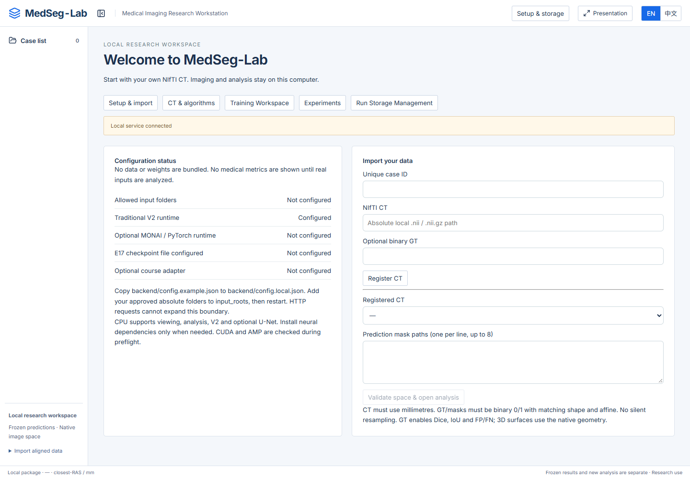
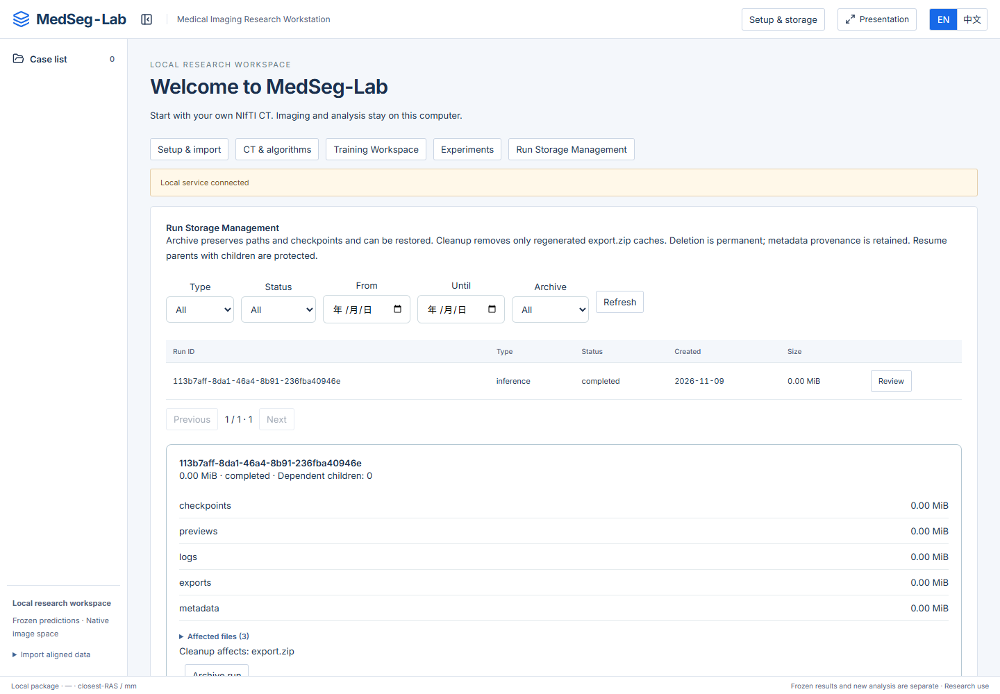

# MedSeg-Lab

**v0.6.0-rc.1 — local source candidate for owner review.** [Candidate handoff](docs/RELEASE_CANDIDATE_HANDOFF.md) · [Source audit](docs/PUBLIC_SOURCE_AUDIT.md) · [Publication checklist](docs/PUBLICATION_CHECKLIST.md). No public release has been performed.

A local research workstation for inspecting 3D CT, comparing binary segmentation masks, running Traditional V2, and monitoring a supported MONAI residual U-Net adapter. English is the default; 中文 is available throughout the workspaces.

Research software. No clinical validation or diagnostic use is claimed. Data, pretrained weights and historical research results are **not included**.



## What you can do

- Inspect synchronized single, dual and quad CT/mask views with physical geometry, linked 3D surfaces and connected components.
- Import a NIfTI CT, optional binary ground truth, and up to eight aligned prediction masks. With GT, inspect native-volume Dice/IoU and TP/FP/FN. Without GT, overlap metrics remain unavailable.
- Run seed/ROI-based Traditional V2 on CPU. Optionally install PyTorch/MONAI for the supported 2D residual U-Net training adapter and verified frozen E17 inference resources.
- Follow real sequenced training events, inspect experiments and compare histories. Resume only at completed configured-epoch boundaries with strict code/data/environment/device checks.
- Inspect storage by run, type, date and status; reversibly archive runs; review cache cleanup or explicit permanent deletion. Parent runs referenced by resume children are protected.

## Install on Windows

Supported/tested baseline: **Windows x64, Python 3.11, Node 22.12+ or 24 LTS, pnpm 11**. Install those tools first and run from a source checkout:

```powershell
.\scripts\Setup-Phase3B.ps1 -Python python
.\Start-Phase3B.ps1
```

The default installation supports imaging, analysis and Traditional V2 without Torch, CUDA, course files or checkpoints. Setup creates an isolated `backend/.venv`, installs pinned core dependencies and the frozen frontend lock, and builds the app. The launcher checks required imports, build output and ports 8008/5173; it refuses occupied ports and closes only services it owns. Use `-NoBrowser` to skip opening the browser.

For the optional neural adapter, use **one** of:

```powershell
.\scripts\Setup-Phase3B.ps1 -Python python -Neural  # CPU Torch
.\scripts\Setup-Phase3B.ps1 -Python python -Cuda    # CUDA 12.6 Torch
```

See [installation and troubleshooting](docs/INSTALLATION.md), including existing development environments that inherit system packages. A second physical machine has **NOT BEEN TESTED**; isolated environments on one machine are reported separately.

## First use and your own inputs

The first screen provides configuration status and import controls. It shows no example patients or invented medical metrics.

1. Copy `backend/config.example.json` to the Git-ignored `backend/config.local.json`.
2. Put approved local absolute directories in `input_roots` and restart the launcher. Leave `source_root` and `checkpoint` empty for ordinary data import. HTTP cannot expand allowed folders.
3. In **Setup & import**, register a unique case ID, CT path and optional GT path. The **CT & algorithms** tab provides CT viewing and seed/ROI controls without requiring a pretrained model.
4. Supply one prediction-mask path per line and choose **Validate space & open analysis**. Shape, affine and millimetre geometry must match; masks must contain exact 0/1 labels. Inputs are not silently resampled.
5. Use the existing comparison, spatial-error and 3D tabs. **Setup & storage** returns to configuration, experiments and storage tools.

[Input workflow and adapter scope](docs/IMPORT_WORKFLOW.md) · [NIfTI/data contract](docs/DATA_FORMAT.md) · [Training workspace](docs/TRAINING_WORKSPACE.md)

## Algorithms and hardware

Traditional V2 is CPU based. Optional E17 inference supports CPU or available CUDA; the checkpoint must match the documented frozen SHA and schema. General training currently supports **only `monai-resunet-v1`**, the vendored MONAI 2D residual U-Net architecture and preprocessing. An arbitrary model or weight file is not a plug-and-play adapter.

CPU training uses FP32 with AMP disabled and may be slow. CUDA is checked during preflight; AMP requires CUDA. Exact recovery across devices, drivers or code changes is not promised. Do not use engineering smoke-run scores as research performance results.

## Storage, safety and privacy



All generated artifacts stay in `runs/`; inputs remain read-only. Archive is a reversible metadata flag that preserves paths and checkpoint references. Cleanup removes only regenerable `export.zip` caches. Permanent deletion requires the full Run ID and a current reviewed impact token, refuses active runs and parents with children, and retains private provenance tombstones. No automatic pruning is performed. Tombstones and exports can contain local paths and must remain private.

Atomic JSON events, run records and checkpoints remain authoritative. SQLite is a rebuildable derived index, reconciled against source files without a stale TTL. Existing runs need no destructive migration. Per-entry link/path safety checks remain enabled; preflight still performs full capacity safety checks.

The application binds to loopback and uses local Origin/Host and session-token checks. It is designed for a single local researcher, not public hosting or multi-user isolation. Do not add patient data, runs, local configurations, logs or model weights to Git. [Release readiness](docs/RELEASE_READINESS.md) distinguishes development QA from permission to publish.

## Architecture and development

```text
React / TypeScript / Three.js  ->  local FastAPI service
                                 |-- validated NIfTI analysis / V2
                                 |-- optional MONAI worker + checkpoint runtime
                                 |-- atomic JSON authority + derived SQLite index
                                 `-- private runs / imports / storage operations
```

```powershell
.\scripts\Setup-Phase3B.ps1 -Python python -Dev
.\backend\.venv\Scripts\python.exe -B -m pytest backend/tests
.\backend\.venv\Scripts\python.exe -B -m unittest discover -s tests
pnpm --dir frontend run build
```

Neural and course-equivalence integration tests require their explicitly configured optional resources; core tests do not impersonate those results. See [Phase 3B implementation](docs/PHASE3B_IMPLEMENTATION.md), [QA](docs/PHASE3B_QA.md), [runtime architecture](docs/TRAINING_RUNTIME_ARCHITECTURE.md) and [release handoff](docs/RELEASE_HANDOFF.md).

## License and attribution

MedSeg-Lab code is under the [MIT License](LICENSE), following the owner's explicit confirmation of course-source and new-code authorization. Third-party code and bundled fonts retain their own licenses: [sources, notices and inventories](docs/THIRD_PARTY_LICENSES.md). The software license grants no rights to medical data or pretrained weights.

For attribution, cite **MedSeg-Lab**, the exact source commit/tag you used, adapter version and configuration. Cite MONAI/PyTorch and the original dataset separately when they are actually used; do not cite an engineering smoke run as a scientific benchmark.

中文入口：[安装说明](docs/INSTALLATION.md#中文快速开始) · [导入工作流](docs/IMPORT_WORKFLOW.md#中文提示) · [发布准备与限制](docs/RELEASE_READINESS.md)
